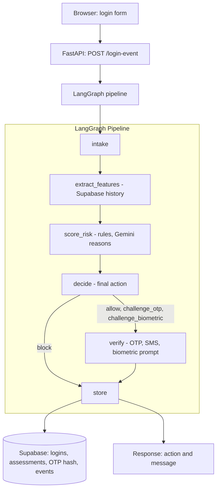

# SecureAuth AI Copilot

**Behavioral login-risk scoring with step-up verification and an audit trail.**

SecureAuth AI Copilot compares each login attempt with that user's own login history and decides whether to allow it, ask for a second proof, or block it. The risk score is computed by fixed, transparent rules. A language model is used only to write plain-English reasons for the audit log and never changes the score.

[Live Demo](https://secureauth-ai-copilot-1.onrender.com) | [Full Documentation](docs/SecureAuth-AI-Copilot-Documentation.pdf)

---

## Why SecureAuth AI Copilot

A correct password is not proof of identity. Production banking and fintech apps add step-up checks when a login looks unusual. This project implements that decision layer as a small, explainable pipeline:

```
extract features -> score risk -> decide action -> verify -> store audit trail
```

## Key Features

- **Rule-based risk score (0 to 1)** from device, location, login hour, attempt rate, and IP flag signals
- **Four outcomes:** `allow`, `challenge_otp`, `challenge_biometric`, and `block`
- **LLM explanations only:** Gemini writes 1 to 4 reasons for the audit log; if it fails, rule-written reasons are used and the score is unchanged
- **Secure OTP handling:** 6-digit codes generated with `secrets`, only the SHA-256 hash stored, 5-minute expiry, constant-time comparison, single use
- **SMS delivery for the demo account** through Textbelt; the API never returns the OTP digits
- **Hard block rule:** more than 10 attempts in an hour is denied regardless of score
- **Full audit trail** in Supabase: logins, assessments, OTP hashes, and security events

## Architecture

### Pipeline



### Components

| Component | Responsibility |
|---|---|
| **Pattern Agent** | Compares the login with the user's last 20 logins (new device, new location, unusual hour, attempts in the last hour) |
| **Risk Scoring Agent** | Adds fixed weights, caps the score at 1.0, assigns a level, and asks Gemini for audit reasons |
| **Decision Agent** | Chooses the final action, including the hard block rule |
| **Verification Agent** | Issues the OTP, stores its hash, sends SMS for the demo account, or returns a biometric prompt |
| **Supabase client** | Reads history and writes logins, assessments, OTP challenges, and security events |
| **FastAPI + static UI** | Login form, decision panel, and OTP box |

## Risk Scoring

| Signal | Weight |
|---|---|
| New device | 0.30 |
| New location | 0.20 |
| Unusual hour | 0.15 |
| 3 or more attempts in the last hour | 0.25 |
| Flagged IP | 0.40 |

The score is the sum of the weights, capped at 1.0.

| Score | Level | Action |
|---|---|---|
| Below 0.30 | Low | `allow` |
| 0.30 to below 0.70 | Medium | `challenge_otp` |
| 0.70 and above | High | `challenge_biometric` |
| More than 10 attempts in an hour | Any | `block` |

Thresholds are configurable through environment variables.

## Tech Stack

| Layer | Technology |
|---|---|
| Language | Python 3.12 |
| API | FastAPI, Uvicorn |
| Orchestration | LangGraph |
| Schemas | Pydantic |
| LLM (reasons only) | Google Gemini |
| SMS | Textbelt |
| Database | Supabase (Postgres) |
| Frontend | HTML, CSS, JavaScript (single page) |
| Deployment | Render |

## API

| Method | Endpoint | Description |
|---|---|---|
| `GET` | `/` | Login page |
| `GET` | `/demo-profile` | Demo account details |
| `POST` | `/login-event` | Assess a login; returns the action, assessment, and message |
| `POST` | `/verify-otp` | Verify a one-time code |

## Run Locally

### Prerequisites

- Python 3.12+
- A Supabase project
- A Gemini API key (optional; scoring works without it)

### Steps

**1. Clone the repository**

```bash
git clone https://github.com/Ayush-2308/SecureAuth-AI-Copilot.git
cd SecureAuth-AI-Copilot
```

**2. Create and activate a virtual environment**

```bash
python -m venv .venv
.venv\Scripts\activate           # Windows
# source .venv/bin/activate      # macOS / Linux
```

**3. Install dependencies**

```bash
pip install -r requirements.txt
```

**4. Configure environment variables**

```bash
copy secureauth\.env.example .env      # Windows
# cp secureauth/.env.example .env      # macOS / Linux
```

Fill in your values in `.env`. See [Environment Variables](#environment-variables).

**5. Set up the database**

Run `secureauth/db/migrations.sql` once in the Supabase SQL editor.

**6. Start the server** (from the repository root)

```bash
python -m uvicorn main:app --host 127.0.0.1 --port 8001
```

**7. Open the app**

- UI: https://secureauth-ai-copilot-1.onrender.com

## Environment Variables

| Variable | Description | Default |
|---|---|---|
| `SUPABASE_URL` | Supabase project URL | Required |
| `SUPABASE_KEY` | Supabase API key | Required |
| `LLM_API_KEY` | Gemini key for audit reasons | Optional |
| `LLM_PROVIDER` | `google` or `gemini` | `google` |
| `RISK_THRESHOLD_MEDIUM` | Start of the medium band | `0.3` |
| `RISK_THRESHOLD_HIGH` | Start of the high band | `0.7` |
| `TEXTBELT_KEY` | Textbelt SMS key | `textbelt` (free tier) |

Never commit your `.env` file.

## Documentation

For the full pipeline details, behavioral feature rules, measured demo results, OTP and SMS flow, database tables, and known limitations, see [docs/SecureAuth-AI-Copilot-Documentation.pdf](docs/SecureAuth-AI-Copilot-Documentation.pdf).

## Author

**Ayush**
GitHub: [@Ayush-2308](https://github.com/Ayush-2308)
